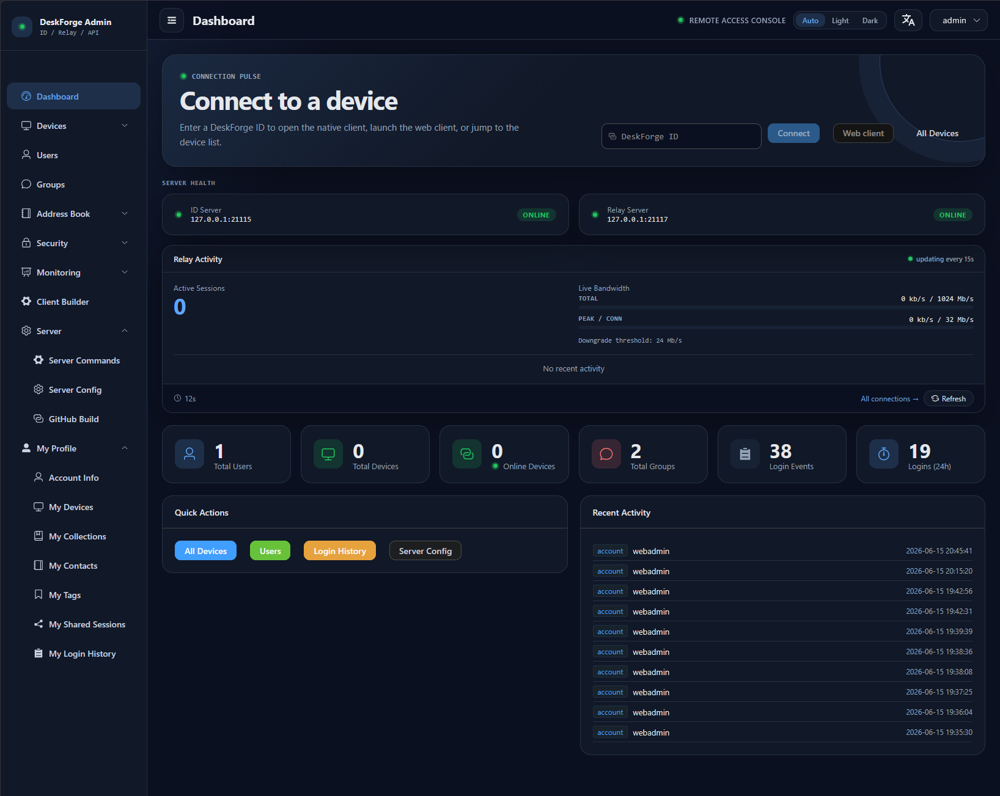

<div align="center">

# DeskForge

### Unified self-hosted RustDesk-compatible server

**One Docker image (s6-overlay): Rust hbbs/hbbr · Go API · Vue 3 admin panel · custom client builder**

[](LICENSE)
[](docker/)
[](AGENTS.md)
[](PLAN.md)

</div>

---

## 🧭 What is it?

DeskForge runs the whole RustDesk stack yourself: ID/relay servers, a REST API with auth,
a browser admin panel — plus a guarded **custom client builder** that produces a branded
Windows client through an owned GitHub Actions workflow in our RustDesk fork.

| Directory | Component | Role |
| --- | --- | --- |
| `server/` | Rust **hbbs + hbbr** | ID/signaling (21116) and relay (21117 / 21119) |
| `api/` | Go REST API (Gin + GORM) | Auth, users, audit, custom builds — port 21114 |
| `admin-ui/` | Vue 3 + Element Plus | Admin panel served at `/admin/` |
| `libs/hbb_common/` | Shared Rust library | Tracked copy of our fork @ recorded pin + patches |
| `docker/` | Image + compose | Single-image (s6-overlay) packaging |
| `github-build/`, `rdgen/` | 📘/❄️ reference | Workflow docs / vendored historical material — no executable copies |
| `win-builder/`, `offline-kit/`, Docker build agents (`docker/Dockerfile.build-linux` / `Dockerfile.build-win`) | ❄️ frozen | Manual/historical-only builders · dependency-freeze tool |

---

## 📸 Screenshots

| Dashboard | Custom Client Builder |
|---|---|
|  |  |

---

## 🚀 Quick start

```bash
git clone https://github.com/bashrusakh/DeskForge.git
cd DeskForge/docker
# fresh checkout: create repository-root .env from .env.example first
# docker-compose.yml: replace your-server, your-secret-jwt-key-change-this
docker compose up -d
docker compose exec rustdesk cat /data/id_ed25519.pub   # public key
```

- **Admin:** `http://your-server:21114/admin/` — login `admin`, password in logs.
- **RustDesk client:** ID Server `your-server:21116`, Relay `your-server:21117`, API `http://your-server:21114`, Key — paste the public key read above (stored at `/data/id_ed25519.pub` in the container).
- `.env` details, `RUSTDESK_API_RUSTDESK_PUBLIC_*` builder prefill, and the uploads upgrade migration: [docs/DEPLOYMENT.md](docs/DEPLOYMENT.md).

---

## 🔌 Ports

| Port  | Protocol | Service          |
| ----- | -------- | ---------------- |
| 21114 | TCP      | API + Web Admin  |
| 21115 | TCP      | NAT type test    |
| 21116 | TCP/UDP  | ID Server (hbbs) |
| 21117 | TCP      | Relay Server (hbbr) |
| 21118 | TCP      | WebSocket        |
| 21119 | TCP      | Relay WebSocket (hbbr) |

Production Compose publishes **21114–21118**; expose 21119 separately when the public relay WebSocket path is required.

**Status:**

- The client builds from the owned fork [`bashrusakh/rustdesk`](https://github.com/bashrusakh/rustdesk) — currently **1.5.3** (version lives in the fork's `Cargo.toml`).
- DeskForge's tracked pin: `libs/hbb_common` @ **`fae47e024dd8`** — the rustdesk 1.5.1/1.5.3 line, re-pinned 2026-11-23.
- Schema/migration state and evidence: [PLAN.md §2](PLAN.md#2-architecture).

---

## ⚙️ Environment

| Variable                           | Purpose                           |
| ---------------------------------- | --------------------------------- |
| `RELAY`                              | Relay server address              |
| `HBBR_PORT`                          | Relay server port                 |
| `HBBS_PORT`                          | ID/Rendezvous server port         |
| `ENCRYPTED_ONLY`                     | Encrypted connections only        |
| `MUST_LOGIN`                         | Require login before connect      |
| `RUSTDESK_API_RUSTDESK_ID_SERVER`    | ID server (hbbs)                  |
| `RUSTDESK_API_RUSTDESK_RELAY_SERVER` | Relay server (hbbr)               |
| `RUSTDESK_API_RUSTDESK_API_SERVER`   | API server URL                    |
| `RUSTDESK_API_RUSTDESK_PUBLIC_ID_SERVER`    | External/public ID server — builder prefill (optional) |
| `RUSTDESK_API_RUSTDESK_PUBLIC_RELAY_SERVER` | External/public relay server — builder prefill (optional) |
| `RUSTDESK_API_RUSTDESK_PUBLIC_API_SERVER`   | External/public API server — builder prefill + local-asset origin (optional) |
| `RUSTDESK_API_KEY_FILE`              | Path to public key file           |
| `RUSTDESK_API_JWT_KEY`               | JWT secret                        |
| `RUSTDESK_API_GORM_TYPE`             | sqlite / mysql / postgresql       |
| `RUSTDESK_API_LANG`                  | en / es / fr / ko / ru / zh_CN / zh_TW (every locale in `api/resources/i18n/`) |
| `SECRET_ENCRYPTION_KEY`              | AES-GCM key for secrets at rest   |
| `SOURCE_DATE_EPOCH`                  | Trusted Docker build timestamp (optional) |

Full semantics (secret-key behavior, public-origin rules, `SOURCE_DATE_EPOCH`): [docs/DEPLOYMENT.md](docs/DEPLOYMENT.md).

---

## ✨ Features

**Everything runs on your own server**

- One Docker image: ID/relay servers, REST API, and browser admin panel.

**Access control and audit**

- JWT, OAuth (GitHub/Google/OIDC), and LDAP authentication; audit log; captcha and brute-force protection.
- Secrets encrypted at rest; server commands persist with their own audit trail.

**Build your own client**

- The API dispatches an owned workflow in our configured RustDesk fork.
- It builds a branded Windows client; the exact provider artifact is validated and published locally.

| Area | Capabilities |
| --- | --- |
| **Server (Rust + Go)** | user CRUD · JWT · OAuth (GitHub/Google/OIDC) · LDAP · groups · tags · address book (personal + shared collections) · peer-UUID binding · audit · server commands with persistence and audit log · encrypted-at-rest secrets · captcha & brute-force protection |
| **Admin UI (Vue 3)** | 16 pages: login, register, dashboard, devices, users, groups, tags, OAuth, server config, audit, custom client builder, address book, guest sharing, workspace, Server Commands, error page · 3 locales (en/ru/zh_CN) · light/dark/auto themes · shared DataTable / AppDialog / AppDrawer / FilterBar / ActionsToolbar |
| **Custom client** | owned fork workflow · exact provider artifact · local validation/publication |

**Not implemented (vs RustDesk Pro):** 2FA, RBAC, session recording, device policy, remote script, HA, backup/restore.

**Evidence:**

- SQLite/MySQL/PostgreSQL drivers configured — SQLite is locally exercised; MySQL/PostgreSQL migration and read/write coverage remain unverified.
- Windows only today; Linux/Android gated pending PR11 evidence; **no live provider run or clean-environment build is claimed.**
- Details: [PLAN.md §2](PLAN.md#2-architecture) · fine-grained PAT permissions: [api/README.md](api/README.md#github-fine-grained-pat-permissions).

---

## 🛠 Build & develop

| Task | Directory | Command |
| --- | --- | --- |
| Full image | `docker/` | `docker compose build && docker compose up -d` |
| API dev stack | `api/` | `docker compose -f docker-compose-dev.yaml up -d` |
| Rust server | `server/` | `cargo build --release && cargo clippy && cargo test` |
| Go API build | `api/` | `go build -o release/apimain cmd/apimain.go` |
| Go checks | `api/` | `GOWORK=off go vet ./... && GOWORK=off go test ./...` |
| Admin UI | `admin-ui/` | `npm install && npm run dev && npm run build` |

Redis integration tests/benchmarks are opt-in (`DESKFORGE_TEST_REDIS_ADDR`); no live Redis run is recorded. Other release/build gates: [PLAN.md §2](PLAN.md#2-architecture).

---

## 🍴 Forks

Two owned repositories back custom-client builds:

- [`bashrusakh/rustdesk`](https://github.com/bashrusakh/rustdesk) — the client fork; the client is built from it, currently **1.5.3** (`Cargo.toml` on `master`).
- [`bashrusakh/hbb_common`](https://github.com/bashrusakh/hbb_common) — mirror of `rustdesk/hbb_common`; auto-sync installed and active (schedule-fire proof pending), never behavioral patches.

DeskForge's `libs/hbb_common/` copy pins **`fae47e024dd8`** — the `rustdesk/rustdesk` 1.5.1/1.5.3 `hbb_common` line, re-pinned 2026-11-23.

Canonical: workflow ownership (the fork's `.github/workflows/` are the sole executable source), topology, sync rules, pin bookkeeping → [docs/FORKS-AND-PINS.md](docs/FORKS-AND-PINS.md) · New-upstream procedure → [PLAN.md §7](PLAN.md#7-fork-maintenance-procedure-for-a-new-upstream-rustdesk-client-release) · Pin + patch record → [`libs/hbb_common/UPSTREAM.md`](libs/hbb_common/UPSTREAM.md).

---

## 📚 Documentation

| Document | Contents |
| --- | --- |
| [PLAN.md](PLAN.md) | Project SSOT: goal, architecture, status, roadmap, fork procedure |
| [AGENTS.md](AGENTS.md) | Repo map, stack, build commands, agent constraints |
| [CONTRIBUTING.md](CONTRIBUTING.md) | Branch model, dev commands, PR and review rules |
| [CHANGELOG.md](CHANGELOG.md) | Release history |
| [docs/FORKS-AND-PINS.md](docs/FORKS-AND-PINS.md) | Fork topology, sync rules, pin bookkeeping |
| [docs/DEPLOYMENT.md](docs/DEPLOYMENT.md) | `.env` setup, upgrade migration, environment in depth |
| [`libs/hbb_common/UPSTREAM.md`](libs/hbb_common/UPSTREAM.md) | `hbb_common` pin + patch record |

---

## 📜 License

The combined DeskForge distribution is identified as **AGPL-3.0** for the covered
DeskForge work. This does not relicense separate or independent components: component-level
notices and upstream licenses remain documented in [LICENSE](LICENSE) and [NOTICE](NOTICE),
and the API/admin UI retain their upstream MIT notices where applicable. The license
inventory is incomplete; no signatures or attestations are recorded, and no full
sovereignty claim is made.

Based on:
- [rustdesk/rustdesk-server](https://github.com/rustdesk/rustdesk-server) (AGPL-3.0)
- [lejianwen/rustdesk-api](https://github.com/lejianwen/rustdesk-api) (MIT)
- [lejianwen/rustdesk-api-web](https://github.com/lejianwen/rustdesk-api-web) (MIT; base: vue-manage-system, MIT)
- [bryangerlach/rdgen](https://github.com/bryangerlach/rdgen) (GPL-3.0, reference material only)
