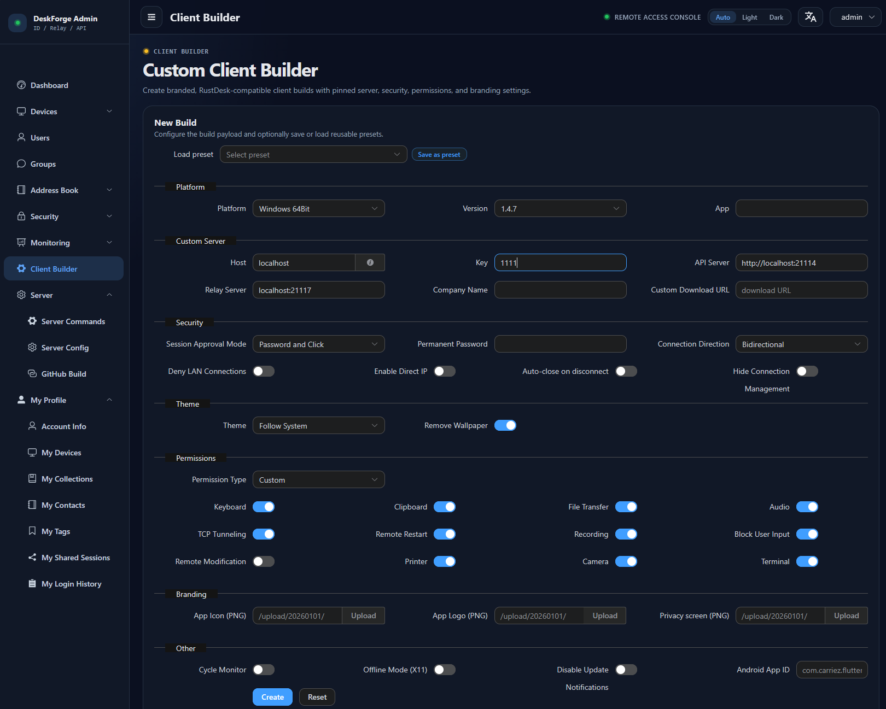

<div align="center">

# DeskForge

**Self-hosted, RustDesk-compatible server in a single Docker image**

ID/relay servers · REST API · web admin panel · custom Windows client builder

[](LICENSE)
[](AGENTS.md)

</div>

## What is it?

DeskForge runs the whole RustDesk backend on your own server and adds a browser admin
panel. It can also build a branded Windows RustDesk client through a GitHub Actions
workflow in your own RustDesk fork.

| Directory | What it is |
| --- | --- |
| `server/` | Rust ID/signaling (`hbbs`) and relay (`hbbr`) servers |
| `api/` | Go REST API (Gin + GORM): auth, users, address book, audit, client builds |
| `admin-ui/` | Vue 3 + Element Plus admin panel, served at `/admin/` |
| `libs/hbb_common/` | Shared Rust library (tracked copy of our fork, with patches) |
| `docker/` | Single-image (s6-overlay) packaging and compose file |

`github-build/`, `rdgen/`, `win-builder/` and `offline-kit/` are reference or historical
material, not part of the running system.

## Features

- Users, groups, tags, personal and shared address books, guest sharing, audit log
- Login via JWT, OAuth (GitHub, Google, OIDC) or LDAP; captcha and brute-force protection
- Admin panel in English, Russian and Chinese (zh_CN), light/dark themes
- Custom client builder: branded Windows client with your server address, key and
  password baked in (Windows only for now; Linux and Android are not enabled yet)

Not implemented compared to RustDesk Pro: 2FA, RBAC, session recording, device policy,
remote scripts, HA, backup/restore.

| Dashboard | Custom Client Builder |
|---|---|
|  |  |

## Quick start

```bash
git clone https://github.com/bashrusakh/DeskForge.git
cd DeskForge
cp .env.example .env            # set SECRET_ENCRYPTION_KEY at least
cd docker
# in docker-compose.yml: set RUSTDESK_API_JWT_KEY and replace the
# localhost addresses with your server's public address
docker compose up -d
docker compose exec rustdesk cat /data/id_ed25519.pub   # server public key
```

- **Admin panel:** `http://your-server:21114/admin/`, login `admin`; the generated
  password is printed once in the container log (`docker compose logs | grep "Admin Password"`).
- **RustDesk client:** ID server `your-server:21116`, relay `your-server:21117`,
  API `http://your-server:21114`, key = the public key printed above.

All settings are documented in [`.env.example`](.env.example); details, upgrade notes and
the custom-builder address settings are in [docs/DEPLOYMENT.md](docs/DEPLOYMENT.md).

## Ports

| Port | Protocol | Service |
| --- | --- | --- |
| 21114 | TCP | API + admin panel |
| 21115 | TCP | NAT type test |
| 21116 | TCP/UDP | ID server (hbbs) |
| 21117 | TCP | Relay (hbbr) |
| 21118 | TCP | hbbs WebSocket |
| 21119 | TCP | hbbr WebSocket (not published by the default compose file) |

## Build and develop

| Task | Directory | Command |
| --- | --- | --- |
| Full image | `docker/` | `docker compose build && docker compose up -d` |
| API dev stack | `api/` | `docker compose -f docker-compose-dev.yaml up -d` |
| Rust server | `server/` | `cargo build --release && cargo clippy && cargo test` |
| Go API | `api/` | `go build -o release/apimain cmd/apimain.go` |
| Go checks | `api/` | `GOWORK=off go vet ./... && GOWORK=off go test ./...` |
| Admin UI | `admin-ui/` | `npm install && npm run dev` (`npm run build` for production) |

Contributing: [CONTRIBUTING.md](CONTRIBUTING.md). Repo layout and agent rules: [AGENTS.md](AGENTS.md).

## More documentation

| Document | Contents |
| --- | --- |
| [docs/DEPLOYMENT.md](docs/DEPLOYMENT.md) | `.env` setup, upgrading, environment details |
| [docs/FORKS-AND-PINS.md](docs/FORKS-AND-PINS.md) | RustDesk and `hbb_common` forks, pins, sync |
| [api/README.md](api/README.md) | API layout, endpoints, custom-build contracts |
| [PLAN.md](PLAN.md) | Architecture, status, roadmap |
| [CHANGELOG.md](CHANGELOG.md) | Release history |

## License

AGPL-3.0 (see [LICENSE](LICENSE)). Bundled and derived components keep their own
licenses; see [NOTICE](NOTICE). Based on
[rustdesk-server](https://github.com/rustdesk/rustdesk-server) (AGPL-3.0),
[rustdesk-api](https://github.com/lejianwen/rustdesk-api) and
[rustdesk-api-web](https://github.com/lejianwen/rustdesk-api-web) (MIT).
